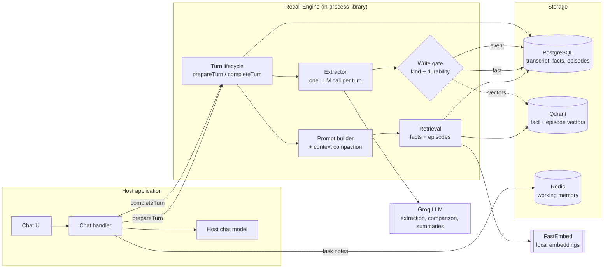
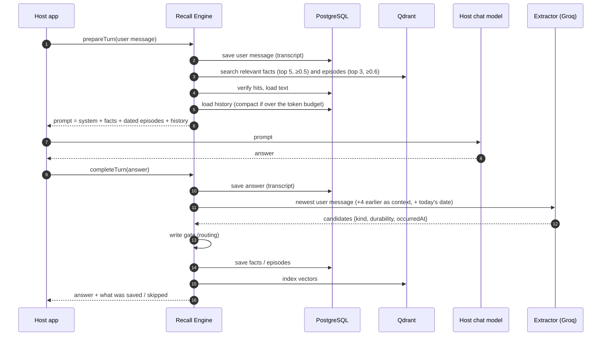
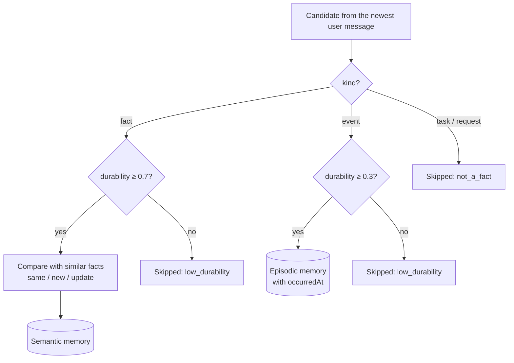

# Recall Engine

**Memory infrastructure for AI agents.** Recall Engine is a TypeScript library that a host application imports so its assistant can remember: what is happening right now, what happened before, and what is true about the user. The host app keeps full control of its own chat model. Recall Engine handles storing, extracting and recalling memory around each turn.

## What we are building

An agent that feels like it *knows* you: it remembers your preferences, recalls what happened to you and when, and keeps track of the task in hand, without the host app writing any memory logic.

The design is modelled on how people remember:

| Layer | What it holds | Example | Lifetime | Store |
|---|---|---|---|---|
| **Working memory** | State of the current task | "Drafting the API section of https://example.com/spec" | Minutes (30 min TTL) | Redis |
| **Episodic memory** | Dated events in the user's life | "Broke their leg on 2026-11-26, bedridden ~2 months" | Long-term | Postgres + Qdrant |
| **Semantic memory** | Lasting facts and preferences | "The user is vegetarian" | Long-term, can be superseded | Postgres + Qdrant |
| **Transcript** *(not a memory)* | Every message, verbatim; the source of truth that memories cite | the raw chat | Permanent | Postgres |

The transcript is kept separate from episodic memory on purpose: messages are evidence, while episodes are distilled, dated memories that cite that evidence.

## What we have built

| Capability | Status |
|---|---|
| Transcript: ordered, tenant-scoped messages with safe concurrent appends | ✅ |
| Context compaction: summarizes old messages when a chat outgrows the token budget | ✅ |
| Working memory: Redis notes with a token budget, priority eviction and TTL | ✅ |
| Semantic memory: automatic fact extraction, de-duplication and supersession | ✅ |
| Write gate: the extractor classifies each candidate (`fact` / `event` / `task` / `request`) and scores its durability, so only memories worth keeping are saved | ✅ |
| Episodic memory: event episodes with absolute dates ("last Friday" → `2026-11-20`) | ✅ |
| Recall: relevant facts and dated episodes injected into every prompt | ✅ |
| Memory Lab: a Next.js demo for watching memory turn by turn | ✅ |
| Conversation episodes: a dated summary of each finished conversation | ⏳ planned |
| Automatic routing of `task` items into working memory | ⏳ planned |
| Date-range recall ("what happened last week?") | ⏳ planned |

## Architecture

### Components



The host app owns the conversation model. Recall Engine runs inside the host's process as a library, not as a separate service, and talks to three stores. PostgreSQL is always the source of truth; Qdrant only holds vectors for search, and every search hit is re-checked in PostgreSQL.

### One conversation turn



### The write gate

Every candidate the extractor returns is routed by code, not by the LLM:



Durability is calibrated in the extractor prompt. Life milestones (a promotion, an injury, a big payout) score 0.7+, notable events (finishing a course) 0.3–0.6, and routine events (coffee, a daily run) under 0.1.

| Message | Result |
|---|---|
| "I got promoted last Friday" | episode, `2026-11-20` |
| "I had my biggest payout today, 10k" | episode, durability ~0.8 |
| "I'm vegetarian" | semantic fact |
| "I had coffee this morning" | skipped (trivial) |
| "Give me a fun fact today" | skipped (request) |

## Quick start

Requires Node.js, Docker, and a Groq API key.

```sh
cp .env.example .env          # set GROQ_API_KEY
npm install
npm run db:up && npm run qdrant:up   # PostgreSQL + Qdrant (also run Redis on 127.0.0.1:6379)
npm run db:generate && npm run db:migrate
npm run build
```

### Use it from your app

```ts
import { connectRecallEngine } from "recall-engine";

const recall = await connectRecallEngine();          // once, at startup
const scope = { tenantId, userId, sessionId };

const conversation = await recall.conversations.create(scope);
const prepared = await recall.conversations.prepareTurn({
  scope,
  conversationId: conversation.id,
  systemPrompt: "You are a helpful assistant.",
  userMessage: "When did I get promoted?",
});

const answer = await yourModel.complete(prepared.prompt.messages); // your own LLM

const completed = await recall.conversations.completeTurn({
  scope,
  preparedTurn: prepared,
  assistantContent: answer,
});
// completed.semanticMemory.result → saved facts, savedEpisodes, skipped (with reasons)

await recall.close();                                // on shutdown
```

Other operations: `recall.workingMemory.*` (task notes), `recall.semanticMemory.*` (retrieve, getById, saveFact, extractAndSave), and `recall.episodicMemory.*` (retrieve, list).

### Run the Memory Lab demo

```sh
cd examples/next-demo
npm install
set -a && . ../../.env && set +a && npm run dev     # http://127.0.0.1:3000
```

Chat on the left. The inspector on the right shows the exact prompt, recalled memories, and what each turn saved or skipped. `/architecture` has an illustrated explainer.

## Configuration

Set these as environment variables, or pass the matching option to `connectRecallEngine`.

| Variable | Default | Purpose |
|---|---|---|
| `DATABASE_URL` | *required* | PostgreSQL |
| `REDIS_URL` | `redis://127.0.0.1:6379` | Working memory |
| `QDRANT_URL` | `http://127.0.0.1:6333` | Vector search |
| `QDRANT_COLLECTION` / `QDRANT_EPISODE_COLLECTION` | `semantic_memories` / `episodes` | Vector collections |
| `GROQ_API_KEY`, `GROQ_MODEL` | model: `openai/gpt-oss-120b` | Extraction, comparison, summaries |
| `RECALL_CONTEXT_INPUT_TOKEN_BUDGET` | 12000 | Prompt budget before compaction |
| `RECALL_WORKING_MEMORY_TOKEN_BUDGET` / `_SESSION_TTL_MS` | 4000 / 1800000 | Working memory limits |
| `RECALL_SEMANTIC_MEMORY_TOP_K` / `_SCORE_THRESHOLD` | 5 / 0.5 | Fact recall |
| `RECALL_SEMANTIC_MEMORY_DURABILITY_THRESHOLD` | 0.7 | Minimum durability to save a fact |
| `RECALL_EPISODIC_MEMORY_TOP_K` / `_SCORE_THRESHOLD` | 3 / 0.6 | Episode recall |
| `RECALL_EPISODIC_MEMORY_EVENT_DURABILITY_THRESHOLD` | 0.3 | Minimum durability to save an event |

## Project layout

```
src/
  recall-engine.ts                 public API (connectRecallEngine) and wiring
  conversation-turn-memory.ts      prepareTurn / completeTurn lifecycle
  conversation-prompt-builder.ts   facts + episodes + history → prompt
  context-compaction.ts            token budgeting and compaction summaries
  episodic-memory.ts               transcript store (name predates ADR 0002)
  semantic-fact-extractor.ts       the extractor prompt (kind, durability, occurredAt)
  semantic-memory-extraction-service.ts  write gate and routing
  semantic-memory*.ts              fact store, vectors, retrieval, comparator
  episode-*.ts                     episode store, vectors, retrieval
  working-memory.ts                Redis task notes
examples/next-demo/                Memory Lab (Next.js)
docs/flow.md                       step-by-step turn flow
```

## Testing

```sh
npm test                 # working memory (Redis)
npm run test:episodic    # everything else (PostgreSQL; LLM and vector calls are faked)
cd examples/next-demo && npm run test:integration
```

Run the PostgreSQL suite with the demo server stopped: one test counts open database connections.

## Further reading

- [`docs/flow.md`](docs/flow.md): the turn flow in detail
- [`IMPROVEMENTS.md`](IMPROVEMENTS.md): deferred improvements
